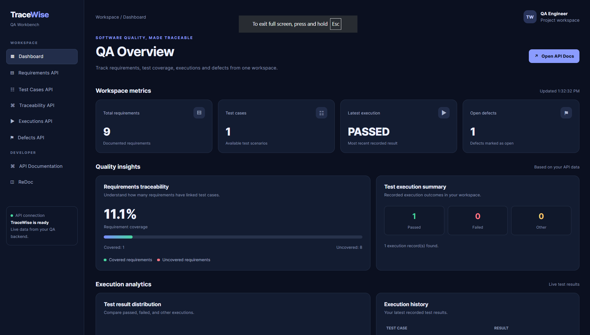

# TraceWise QA Workbench

### A Requirements-Driven Quality Assurance & Test Management Platform

<p align="center">
  <a href="https://tracewise-qa-workbench-main.onrender.com/">
    
  </a>
  <a href="https://tracewise-qa-workbench-main.onrender.com/docs">
    
  </a>
  
  
  <a href="https://github.com/nanivamsi366/tracewise-qa-workbench-main/actions/workflows/ci.yml">
  
</a>
</p>

TraceWise QA Workbench is a web-based Quality Assurance platform designed to organize software testing activities in one centralized workspace. It helps QA engineers manage requirements, create test cases, record test executions, track defects, and monitor requirement coverage through a Requirements Traceability Matrix (RTM).

---

## 📌 Project Overview

The project demonstrates a practical QA workflow by connecting requirements to test cases, executions, and defects.

It combines REST API development, database management, automated API testing, and a live dashboard to demonstrate the software testing lifecycle.

**Live Application:** [TraceWise QA Workbench](https://tracewise-qa-workbench-main.onrender.com/)

**Interactive API Documentation:** [Swagger UI](https://tracewise-qa-workbench-main.onrender.com/docs)

---

## 🎯 Key Features

- **Requirements Management:** Create, retrieve, update, and delete software requirements.
- **Test Case Management:** Create and maintain test cases linked to specific requirements.
- **Test Execution Management:** Record execution status, actual results, execution notes, and tester details.
- **Defect Management:** Track defects using severity, priority, status, and assignment details.
- **Requirements Traceability Matrix (RTM):** Identify covered and uncovered requirements and calculate coverage percentage.
- **REST API:** Access application functionality through FastAPI endpoints.
- **Automated API Testing:** Validate application functionality using pytest and FastAPI TestClient.
- **HTML Test Reports:** Generate readable automated test execution reports.
- **QA Dashboard:** View requirements, test cases, execution results, defects, and traceability metrics.
- **Production Database:** Use PostgreSQL for the deployed application and SQLite for local development.

---

## 🖥️ Dashboard Preview

Visit the live application to explore the dashboard and its QA metrics.



**Live Dashboard:** [Open TraceWise](https://tracewise-qa-workbench-main.onrender.com/)

---

## 🛠️ Technology Stack

| Technology | Purpose |
|---|---|
| Python | Application development |
| FastAPI | REST API development |
| SQLModel | Database models and ORM |
| SQLite | Local development database |
| PostgreSQL | Production database |
| SQLAlchemy | Database connectivity |
| Pytest | Automated testing |
| HTTPX | API testing support |
| Pytest-HTML | HTML test reporting |
| Uvicorn | ASGI application server |
| Render | Application and database hosting |
| Swagger UI | API exploration and validation |

---

## 🏗️ Project Architecture

TraceWise follows a modular architecture that separates API routing, database operations, data models, and automated testing.

```text
TraceWise QA Workbench
│
├── FastAPI Application
│   ├── Requirements Management
│   ├── Test Case Management
│   ├── Test Execution
│   ├── Defect Tracking
│   └── Requirements Traceability (RTM)
│
├── Data Layer
│   ├── SQLModel ORM
│   ├── SQLite (Local)
│   └── PostgreSQL (Production)
│
├── Automated Testing
│   ├── Pytest
│   ├── FastAPI TestClient
│   └── HTML Test Reports
│
└── Dashboard
    ├── QA Metrics
    ├── Coverage Insights
    └── Execution Analytics
```

---

## 📂 Project Structure

```text
tracewise-qa-workbench/
│
├── app/
│   ├── routers/
│   │   ├── requirements.py
│   │   ├── test_cases.py
│   │   ├── execution.py
│   │   ├── defects.py
│   │   └── rtm.py
│   │
│   ├── templates/
│   │   └── dashboard.html
│   │
│   ├── database.py
│   ├── main.py
│   ├── models.py
│   └── schemas.py
│
├── tests/
│   └── test_api.py
│
├── reports/
│   └── test-report.html
│
├── screenshots/
│   └── dashboard.png
│
├── requirements.txt
├── README.md
└── tracewise.db
```

*Note: The local SQLite database is generated during development and should not be committed to GitHub.*

---

## 🔗 API Endpoints

| Module | Method | Endpoint | Description |
|---|---|---|---|
| Requirements | GET | `/api/requirements/` | List requirements |
| Requirements | POST | `/api/requirements/` | Create requirement |
| Requirements | GET | `/api/requirements/{requirement_id}` | Get requirement |
| Requirements | PATCH | `/api/requirements/{requirement_id}` | Update requirement |
| Requirements | DELETE | `/api/requirements/{requirement_id}` | Delete requirement |
| Test Cases | GET | `/api/test-cases/` | List test cases |
| Test Cases | POST | `/api/test-cases/` | Create test case |
| Test Cases | GET | `/api/test-cases/{test_case_id}` | Get test case |
| Test Cases | PATCH | `/api/test-cases/{test_case_id}` | Update test case |
| Test Cases | DELETE | `/api/test-cases/{test_case_id}` | Delete test case |
| RTM | GET | `/api/rtm/` | Get traceability matrix |
| Executions | GET | `/api/executions/` | List executions |
| Executions | POST | `/api/executions/` | Create execution |
| Executions | GET | `/api/executions/{execution_id}` | Get execution |
| Executions | PATCH | `/api/executions/{execution_id}` | Update execution |
| Executions | DELETE | `/api/executions/{execution_id}` | Delete execution |
| Defects | GET | `/api/defects/` | List defects |
| Defects | POST | `/api/defects/` | Create defect |
| Defects | GET | `/api/defects/{defect_id}` | Get defect |
| Defects | PATCH | `/api/defects/{defect_id}` | Update defect |
| Defects | DELETE | `/api/defects/{defect_id}` | Delete defect |
| General | GET | `/` | Home |
| General | GET | `/api/health` | Health check |

Explore the available API operations through the interactive documentation:

[Open Swagger API Documentation](https://tracewise-qa-workbench-main.onrender.com/docs)

---

## ⚙️ Installation & Local Setup

### 1. Clone the Repository

```bash
git clone https://github.com/nanivamsi366/tracewise-qa-workbench-main.git
cd tracewise-qa-workbench-main
```

### 2. Create a Virtual Environment

```bash
python -m venv venv
```

### 3. Activate the Virtual Environment

For Windows PowerShell:

```powershell
.\venv\Scripts\Activate.ps1
```

### 4. Install Dependencies

```bash
python -m pip install -r requirements.txt
```

### 5. Run the Application

```bash
python -m uvicorn app.main:app --reload
```

### 6. Open the Application

| Resource | Local URL |
|---|---|
| Dashboard | http://127.0.0.1:8000/ |
| Swagger API Docs | http://127.0.0.1:8000/docs |
| ReDoc | http://127.0.0.1:8000/redoc |

---

## 🧪 Automated Testing

Run the automated test suite using:

```bash
python -m pytest -v
```

Generate an HTML test report using:

```bash
python -m pytest --html=reports/test-report.html --self-contained-html
```

The HTML report provides a readable summary of automated test execution results.

**Latest verified test result:** 9 tests passed.

---

## 🗄️ Database & Deployment

The application uses two database configurations:

- **SQLite:** Used for local development.
- **PostgreSQL:** Used for the deployed production application.

The production application is hosted on Render and connects to its PostgreSQL database through the `DATABASE_URL` environment variable.

Existing development records were migrated to the production database while preserving record IDs and relationships.

---

## 📊 Current Production Data

The deployed dashboard currently contains:

| Data | Records |
|---|---:|
| Requirements | 9 |
| Test Cases | 1 |
| Test Executions | 1 |
| Defects | 1 |

These records demonstrate requirement coverage, test execution tracking, and defect management.

---

## 🎓 QA Concepts Demonstrated

This project demonstrates practical understanding of:

- Requirement analysis and management
- Test case design and documentation
- Requirements Traceability Matrix (RTM)
- Positive and negative testing
- API testing and validation
- Test execution and result tracking
- Defect reporting and lifecycle management
- Regression testing support
- Automated API testing
- Database relationships and data integrity

---

## 🚀 Future Enhancements

- User authentication and role-based access control
- Advanced test execution analytics
- Test suite and test cycle management
- Defect lifecycle workflow enhancements
- Import and export of test cases
- Advanced reporting and filtering
- CI/CD integration

---

## 🧪 Testing & Quality Assurance

TraceWise QA Workbench has been validated through manual API testing and automated test execution.

### Manual API Testing

- Requirements API — CRUD operations
- Test Cases API — CRUD operations
- Requirements Traceability Matrix (RTM)
- Test Execution API — CRUD operations
- Defects API — CRUD operations
- Dashboard data verification
- Positive and negative API scenarios

📄 **[View Manual API Testing Report](docs/manual-api-test-report.md)**

### Automated Testing

Automated API tests were executed using Pytest.

| Metric | Result |
|---|---:|
| Total Tests | 9 |
| Passed | 9 |
| Failed | 0 |
| Pass Rate | 100% |

📊 **[View Automated HTML Test Report](reports/automated-test-report.html)**

### Testing Tools

- Swagger UI
- Pytest
- Pytest HTML
- FastAPI TestClient

**Testing Outcome:** All 9 automated tests passed, and all documented manual API test scenarios completed successfully.

---

## 👨‍💻 Author

**Taraka Venkata Sai Vamsi Sanaboina**

QA Engineer | Manual Testing | API Testing | Python | FastAPI

**GitHub:** [nanivamsi366](https://github.com/nanivamsi366)

**Project Repository:** [TraceWise QA Workbench](https://github.com/nanivamsi366/tracewise-qa-workbench-main)

---

<p align="center">
  <strong>TraceWise QA Workbench</strong><br>
  Making Software Quality Traceable.
</p>